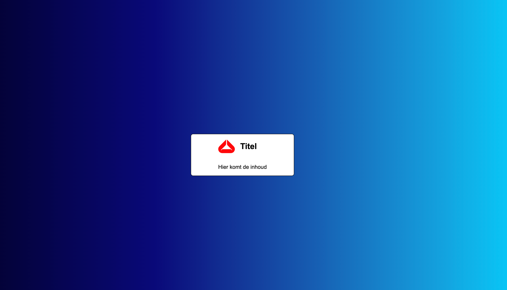

# Labo 09

- Zorg dat Codium en alle nodige extensies zijn geïnstalleerd, zoals beschreven in [Tooling & setup](https://webtechnologie.apload.be/tooling).
- Volg de gegeven bestandenstructuur.
- Controleer het resultaat van je oefening met de Live server extensie.
- Werk de onderstaande oefeningen van boven naar beneden af.
- Gebruik telkens [modern-normalize](https://github.com/sindresorhus/modern-normalize) of het meegeleverde `normalize.css`.
- Zorg ervoor dat de body children zowel verticaal als horizontaal in het midden van de webpagina gecentreerd staan. Gebruik hiervoor CSS Grid.
- Voorzie de achtergrond van de body van een leuke gradient (bijv. via [cssgradient.io](https://cssgradient.io/)).

De algemene layout ziet er zo uit:



## Bestandenstructuur

```
webtechnologie/
├─ labo-09/
│  ├─ username-password/
│  │  ├─ index.html
│  │  └─ css/
│  │     ├─ normalize.css
│  │     └─ style.css
│  ├─ radiobuttons/
│  ├─ upload/
│  ├─ checkboxes/
│  ├─ select/
│  └─ event-registration/
```

## Oefeningen

1. [username-password](./username-password/README.md)
2. [radiobuttons](./radiobuttons/README.md)
3. [upload](./upload/README.md)
4. [checkboxes](./checkboxes/README.md)
5. [select](./select/README.md)
6. [event-registration](./event-registration/README.md)
