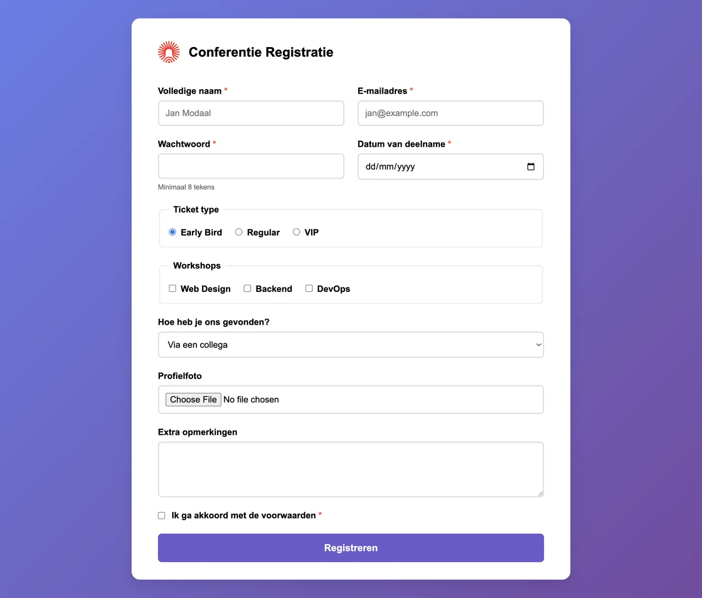

# Conferentie Registratie

Maak een volledig functioneel en responsief registratieformulier voor een tech-conferentie. Dit formulier moet alle geleerde concepten over formulieren en styling combineren.

Kopieer je oplossing van **Username & Password** als vertrekpunt en bouw daarop verder. Behoud de header met het logo en pas de titel aan.

## Onderdelen van het formulier

- **Persoonlijke Gegevens:**
  - Volledige naam (text, verplicht)
  - E-mailadres (email, verplicht)
  - Wachtwoord (password, verplicht, minstens 8 tekens)
- **Registratie Details:**
  - Datum van deelname (date, verplicht)
  - Ticket type (radiobuttons: Early Bird, Regular, VIP)
  - Workshops (checkboxes: Web Design, Backend, DevOps)
  - Hoe heb je ons gevonden? (select: Via een collega, Social media, Nieuwsbrief, Andere)
- **Extra Info:**
  - Profielfoto (file upload)
  - Extra opmerkingen (textarea)
  - Akkoord gaan met de voorwaarden (checkbox, verplicht)
- **Verzenden:**
  - Een duidelijke submit button.

## Technische Eisen

- **Layout & Responsiviteit:**
  - Gebruik **Flexbox** om inputgroepen (bijv. Naam en E-mail) naast elkaar te zetten op grote schermen, maar onder elkaar op mobiel.
  - Zorg ervoor dat het formulier maximaal 800px breed is en gecentreerd staat op de pagina.
  - Gebruik de algemene layout (witte container, gradient achtergrond, padding).
- **CSS Pseudo-classes:**
  - Geef visuele feedback met `:valid` en `:invalid` (bijv. een groene of rode border). Pas deze enkel toe op de tekstuele invoervelden (`text`, `email`, `password`, `date` en de `textarea`). Zet je ze op `input` in het algemeen, dan kleurt ook je file-upload groen, want een niet-verplicht veld is altijd geldig.
  - Herlaad daarna je pagina en kijk naar het resultaat: alle lege verplichte velden staan meteen rood, nog voor je iets getypt hebt. Vervang `:valid` en `:invalid` vervolgens door `:user-valid` en `:user-invalid` en herlaad opnieuw. Beschrijf in een commentaar in je CSS wat het verschil is.
  - Gebruik `:focus` om het actieve veld te accentueren met een paarse `outline`. Verwijder de standaard outline niet zonder er een eigen outline voor in de plaats te zetten, anders zien toetsenbordgebruikers niet meer waar ze zijn.
  - Gebruik `:required` om de labels van verplichte velden subtiel te markeren (bijv. een rood sterretje `*` via een `::after` pseudo-element).
  - De submit button moet een hover effect hebben.
- **Toegankelijkheid:**
  - Elk invoerveld **moet** een bijbehorend `<label>` hebben dat correct gelinkt is via het `for` en `id` attribuut. Dit geldt ook voor elke afzonderlijke radiobutton en checkbox: die krijgen dus allemaal een eigen `id`.
  - Gebruik `<fieldset>` en `<legend>` om logische groepen te maken (bijv. voor Ticket type en Workshops).

## Verwacht resultaat

