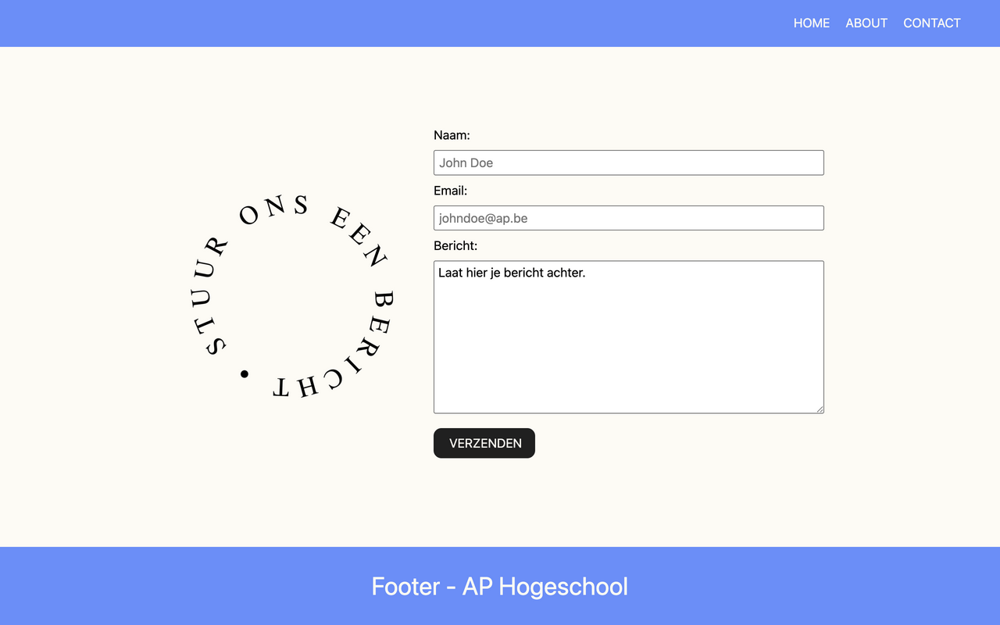

# form

Bouw de contactpagina uit het filmpje na met HTML en CSS. Voor deze oefening krijg je een afbeelding die je kan gebruiken als onderdeel van de animatie.

**Layout**

* De pagina bestaat uit een `header`, een `main` en een `footer`. Gebruik CSS Grid op de `body` met `grid-template-areas` en een hoogte van minstens `100vh`, zodat de footer altijd onderaan staat.
* Header en footer hebben dezelfde achtergrondkleur, `main` een lichte achtergrondkleur. Werk met CSS-variabelen in `:root` zodat je elke kleur maar één keer hoeft te schrijven.
* De footer bevat de tekst "Footer - AP Hogeschool", gecentreerd met flexbox.

**Navigatie**

* De header bevat een `nav` met een lijst van drie links: Home, About en Contact. Zet ze rechts uitgelijnd naast elkaar met flexbox en haal de bolletjes en de onderlijning weg.
* Wanneer de gebruiker over een link gaat, verandert de tekstkleur vloeiend. Gebruik hiervoor `transition`.

**Main**

* In `main` staan de afbeelding en het formulier naast elkaar, gecentreerd met flexbox.
* De afbeelding draait traag en eindeloos rond haar eigen as. Schrijf hiervoor een `@keyframes`-animatie met `transform: rotate(...)` van `0` naar `360deg`. De animatie duurt 15 seconden, gebruikt `linear` en blijft zich herhalen.

**Formulier**

* Voorzie een formulier met drie velden, elk met een `label` boven het invulvak:
  - Naam, een tekstveld met placeholder "John Doe"
  - Email, een veld van het type `email` met placeholder "johndoe@ap.be"
  - Bericht, een `textarea` met als inhoud "Laat hier je bericht achter."
* Koppel elk label aan zijn invulveld via `for` en `id`, en geef elk veld een eigen `name`.
* Onderaan staat een verzendknop met de tekst "Verzenden". Gebruik `text-transform: uppercase` in plaats van de tekst in hoofdletters te typen.
* Wanneer de gebruiker over de verzendknop gaat, verandert de achtergrondkleur en verdwijnen de afgeronde hoeken. Beide veranderingen verlopen vloeiend via `transition` op de knop zelf.

## Verwacht resultaat

Bekijk het filmpje voor de interactie: [opgave.mp4](./opgave.mp4)
