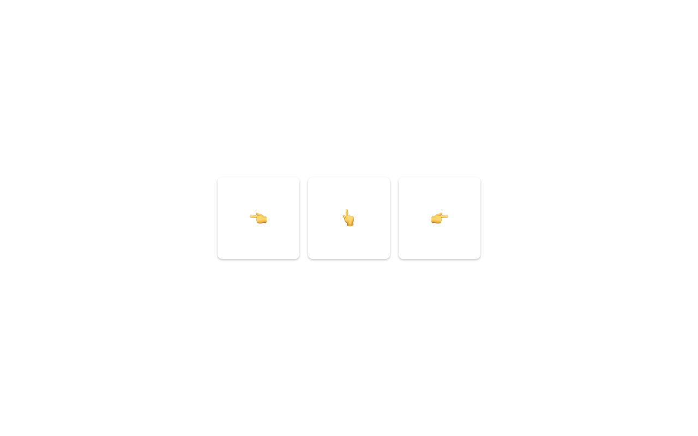

# point

Bouw de tegels uit het filmpje na met HTML en CSS.

* Plaats drie tegels naast elkaar in je `body` en zet ze mooi in het midden van het scherm. Gebruik hiervoor flexbox op de `body` met een hoogte van `100vh`.
* Elke tegel is een vierkant van 150px op 150px met een emoji in het midden: een hand die naar links wijst, een hand die naar boven wijst en een hand die naar rechts wijst. Centreer de emoji met flexbox en maak ze wat groter met `font-size`.
* Voor de tegels voorzie je:
  - afgeronde hoekjes van 8px
  - Gebruik de ingebouwde box-shadow editor van je browser devtools om een soortgelijke box-shadow te genereren.
  - Zorg dat je geen css dupliceert. Hergebruik css classes.
* Wanneer de gebruiker met de muis over een tegel gaat, schuift die tegel op in de richting waar de emoji naar wijst. Gebruik hiervoor de `:hover` pseudo-class met `transform: translateX(...)` of `transform: translateY(...)`.
* De verschuiving verloopt vloeiend. Gebruik hiervoor [transition](https://webtechnologie.apload.be/css/animaties/transities) en let op: de transitie zet je op de tegel zelf, niet op de `:hover`-regel, zodat ze in beide richtingen werkt.

## Tips

- Bekijk [hier](https://support.microsoft.com/en-us/windows/windows-keyboard-tips-and-tricks-588e0b72-0fff-6d3f-aeee-6e5116097942#:~:text=During%20text%20entry%2C%20press%20Windows,from%20GIFs%20and%20Kaomoji%20too!) hoe je het emoji keyboard kunt openen op Windows.
- Bekijk [hier](https://devtoolstips.org/tips/en/edit-shadow/) hoe je de ingebouwde box-shadow generator van Google Chrome gebruikt.

## Verwacht resultaat

Bekijk het filmpje voor de interactie: [opgave.mp4](./opgave.mp4)
